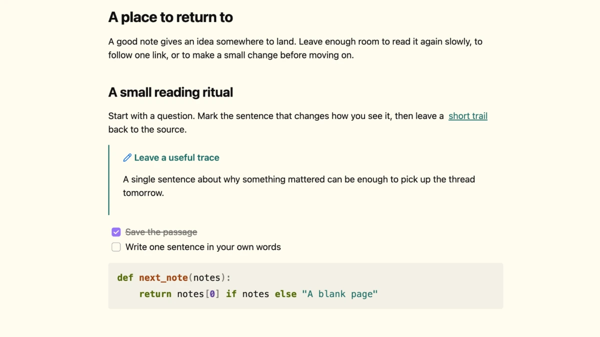
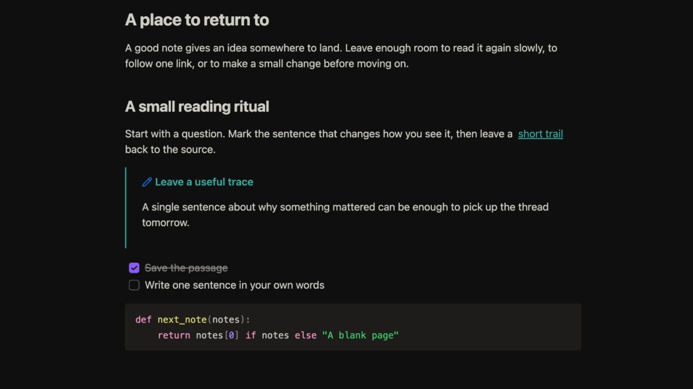

# Cocoo

Cocoo is an Obsidian theme for long reading sessions and everyday note-taking. Light mode pairs warm paper with dark ink, while dark mode uses soft, warm text on a near-black background. Teal links and fine-lined callouts make it easy to find your place without interrupting the flow of a note.

## Light and dark

## Details

- Underlined links and a visible keyboard focus outline on inline note links.
- Blue text selection and amber search marks in the editor.
- Larger fenced code in light-mode Reading view, with heavier keywords and distinct syntax colors.

## Local installation

Copy the `Cocoo` folder, containing `manifest.json` and `theme.css`, into your vault’s `.obsidian/themes/` directory. In Obsidian, select **Cocoo** under **Settings → Appearance → Themes**.

## License

[MIT](LICENSE)
